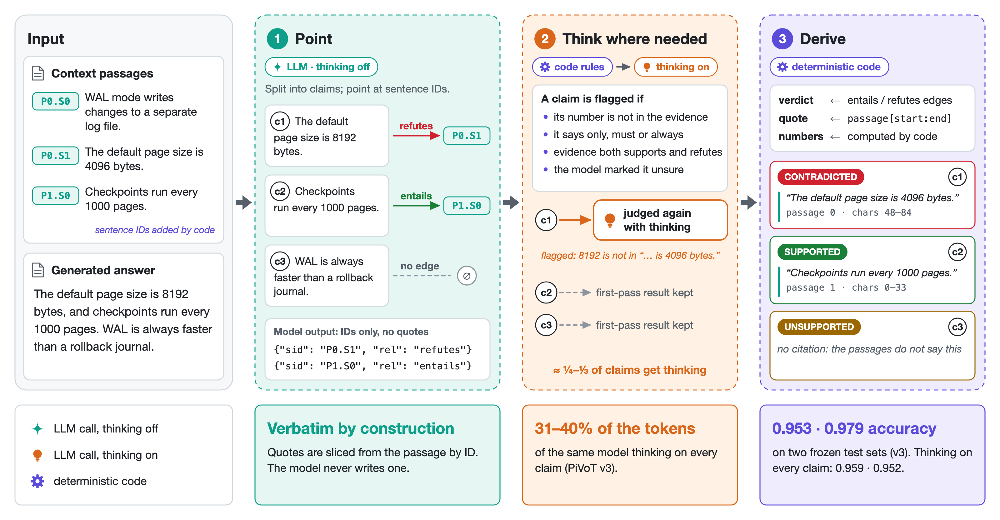
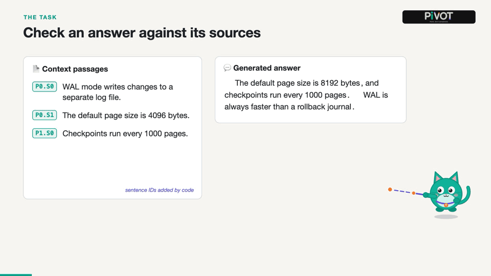

<p align="center">
  
</p>

<h3 align="center">When Paraphrase Is Easy and Logic Is Not:<br>A Reasoning-Stratified Benchmark and Pointer-Based Verifier for Citation Grounding</h3>

**PiVoT** (*Point, don't paraphrase*) checks an LLM answer against its source passages. It splits the answer into
atomic claims, labels each one `SUPPORTED`, `CONTRADICTED` or `UNSUPPORTED`, and returns verbatim quotes with
character offsets. The model only points at sentence IDs. Code slices the quotes, derives the verdicts and does the
arithmetic, and thinking is spent only on the claims that code flags as hard.

This repository is a solution to the
[Citation Grounding & Faithfulness Verifier](https://gist.github.com/wsxiaoys/849522ee389e0ce359ef444653084484)
assignment: a `POST /verify` service, an evaluation set of 65 cases and 717 claims, and a benchmark of three approaches.
See [Quick start](#-quick-start) to run it, [Results](#-results-at-a-glance) for the numbers, and
[Reproduce](#-reproduce) to replay every number without an API key.

<p align="center">
  
</p>
<p align="center">
  <em>Overview of PiVoT on a three-claim answer. ① The model splits the answer and points at sentence IDs; it never
  writes a quote. ② Fixed rules flag the claims that may be wrong, and only those are judged again with thinking.
  ③ Code derives each verdict from the edges and slices each quote from the passage. The verdicts, quotes and offsets
  shown are the service's real output for this request (<a href="examples/">examples/</a>).</em>
</p>

<p align="center">
  <a href="https://haohaha-11.github.io/PiVoT/"></a>
</p>
<p align="center">
  🎬 <a href="https://haohaha-11.github.io/PiVoT/"><b>Watch the narrated demo (2:38)</b></a> · <a href="assets/pivot-demo.mp4">download the mp4</a><br>
  <em>The preview above is silent. The full video has narration and captions; Dot, the PiVoT cat, points at what it describes.</em>
</p>

## 📌 Results at a glance

Both test sets use documentation that development never touched, and both were frozen before any system ran on
them. Every number is the mean of three independent runs. All LLM systems use the same base model,
deepseek-v4.1-flash.

| System | test-1 accuracy | test-2 accuracy | Output tokens / case | Median latency |
|---|---|---|---|---|
| Lexical (word overlap, no LLM) | 0.192 | 0.256 | 0 | 0 s |
| Minimal (thinking off) | 0.898 | 0.875 | 1.2k / 1.3k | 7 s / 6 s |
| Minimal (thinking on) | 0.959 | 0.952 | 6.5k / 6.8k | 34 s / 32 s |
| **PiVoT v3** | **0.953** | **0.979** | **2.6k / 2.1k** | **15 s / 15 s** |
| **PiVoT v4** | **0.974**\* | **0.976** | **3.3k / 3.0k** | **14 s / 16 s** |

Tokens and latency are given as test-1 / test-2. \* v4's changes come from the failure analysis of test-1.

- ✅ **Quotes are verbatim by construction.** The model names sentence IDs, and code slices the quote from the
  passage. Every quote is an exact substring of its passage, with character offsets.
- 🎯 **Accuracy matches or beats the strongest baseline.** PiVoT v3 ties Minimal (thinking on) on test-1 (0.953 vs
  0.959) and is 2.7 points ahead on test-2. v4 is 2.4 points ahead on test-2. Both versions lead in all three runs on
  test-2.
- ⚡ **It costs much less.** Minimal (thinking on) thinks about every claim. PiVoT thinks about a quarter to a third of
  them. v3 uses 31% to 40% of the baseline's output tokens and v4 uses 44% to 50%. Both take less than half its median
  latency.
- 🔀 **Two versions, one switch.** v4 fixes the errors that test-1 exposed and raises test-1 accuracy from 0.953 to
  0.974. v3 is cheaper. The service runs v4 by default, and one environment variable switches to v3.

## 🚀 Quick start

```bash
git clone https://github.com/Haohaha-11/PiVoT.git && cd PiVoT
python -m venv .venv && source .venv/bin/activate
pip install -r requirements.txt
```

Start the service with any OpenAI-compatible endpoint:

```bash
export VERIFIER_API_KEY=...        # DASHSCOPE_API_KEY also works
export VERIFIER_BASE_URL=...       # default: DashScope's OpenAI-compatible endpoint
uvicorn verifier.api:app --port 8000
```

Or try it without an API key. The two LLM calls of the example request are recorded in `examples/cache`:

```bash
VERIFIER_CACHE_DIR=examples/cache VERIFIER_CACHE_MODE=replay uvicorn verifier.api:app --port 8000
curl -s localhost:8000/verify -H 'content-type: application/json' -d @examples/request.json
```

The request:

```json
{
  "context_passages": [
    "WAL mode writes changes to a separate log file. The default page size is 4096 bytes.",
    "Checkpoints run every 1000 pages."
  ],
  "generated_answer": "The default page size is 8192 bytes, and checkpoints run every 1000 pages. WAL is always faster than a rollback journal."
}
```

The response (`examples/response.json`, `meta` shortened):

```json
{
  "claims": [
    {
      "claim_text": "The default page size is 8192 bytes.",
      "verdict": "CONTRADICTED",
      "reasoning": "Passage states the default page size is 4096 bytes, incompatible with the claimed 8192 bytes.",
      "citations": [{"index": 0, "quote": "The default page size is 4096 bytes.", "start_char": 48, "end_char": 84}],
      "answer_span": [0, 35]
    },
    {
      "claim_text": "Checkpoints run every 1000 pages.",
      "verdict": "SUPPORTED",
      "reasoning": "Direct restatement of P1.S0.",
      "citations": [{"index": 1, "quote": "Checkpoints run every 1000 pages.", "start_char": 0, "end_char": 33}],
      "answer_span": [41, 73]
    },
    {
      "claim_text": "WAL is always faster than a rollback journal.",
      "verdict": "UNSUPPORTED",
      "reasoning": "Passages never compare WAL speed to rollback journal.",
      "citations": [],
      "answer_span": [75, 119]
    }
  ],
  "meta": {
    "pipeline": "pivot", "prompt_version": "pivot-v4", "status": "ok", "llm_calls": 2,
    "completion_tokens": 337, "escalated_claims": 1, "escalation_reasons": {"number_not_in_evidence": 1}
  }
}
```

One claim was judged twice. `8192` does not occur in the evidence sentence, so code flagged the claim and it was
judged again with thinking. The other two claims kept their first-pass result.

## 🧪 The benchmark

### A benchmark has to separate systems

**Common evaluation sets saturate quickly on this task.** There are two common ways to build one. Hand-written
cases are easy to control: take a short passage and change a number or flip a negation in the answer. But current
LLMs spot such edits at once, different systems all score above 0.98, and a passage of a few dozen words cannot test
reasoning across passages. Public hallucination datasets are larger, but their labels are at the answer or span
level, which does not match claim-level three-way verdicts with verbatim quotes, and the same predictions can rank
systems in opposite orders under a lenient and a strict labelling.

**An evaluation set needs discrimination and validity.** Discrimination means the scores of different systems
spread out. Validity means a score reflects real ability: the cases test what goes wrong in practice, the gold labels
are reliable, and the test data was not used in development. This section covers discrimination. The next two cover
validity.

**Three pilot rounds and eight models show that discrimination comes from reasoning claims.** In each round we
built cases, ran every model on them, and changed the cases according to the result
([pilot/FINDINGS.md](pilot/FINDINGS.md), in Chinese). Every model ran in two modes. In oracle mode it receives the
gold claims and only judges them. In end-to-end mode it also splits the answer, so the score includes splitting.
The models come from four families: Qwen (qwen3.6-35b-a3b, qwen3.7-plus, qwen3.8-flash, qwen3.8-max), DeepSeek
(deepseek-v4-flash, deepseek-v4.1-flash), Kimi (kimi-k3) and GLM (glm-5.3). All of them use the same minimal prompt.

| Round | Cases / claims | What changed, and why | Result |
|---|---|---|---|
| 1 | 10 / 53 | The common recipe: SQLite WAL and Redis persistence passages, with changed numbers, flipped negations and fabricated details in the answers | Oracle accuracy is 1.00 for three of six models, and no model labels a fabrication `SUPPORTED`. End-to-end accuracy spreads from 0.75 to 0.94, so the spread comes from splitting, not from judging. |
| 2 | 10 / 130 | Harder along every axis: 9 to 11 passages per case, near-miss numbers and versions, superseded statements, only-if conditions, true facts that the passages do not contain, arithmetic, and two natural answers written by glm-5.3 | Oracle accuracy stays between 0.96 and 0.99. Only 9 of 130 claims are missed by any of the five models with valid output, and all 9 involve arithmetic, conditions, versions or scope. Long context, distractors and outside knowledge mislead no model. |
| 3 | 11 / 116 | Only what worked in round 2: 52 reasoning claims (derived numbers, version ranges, contrapositive and converse, exceptions, strength of wording, superseded statements) and 64 paraphrased claims as a false-alarm control. PostgreSQL vacuum documentation added | Paraphrased claims: 1.00 for every model with thinking off. Reasoning claims: 0.73 to 1.00 across models and thinking settings. Turning thinking on moves one model by 13 points. |

**The final lineup re-ran all three rounds.** Model versions change quickly, so we ran every round again with five
current models, with thinking on and, where the provider allows it, off.

| Model | Thinking | Round 1 oracle · e2e | Round 2 oracle · e2e | Round 3 reasoning claims | Round 3 e2e | Round 3 exact quotes | Round 3 median latency | Round 3 output tokens / case |
|---|---|---|---|---|---|---|---|---|
| deepseek-v4.1-flash | on | 1.00 · 1.00 | 0.99 · 0.92 | **1.00** | 0.95 | 1.00 | 27 s | 5.4k |
| deepseek-v4.1-flash | off | – | – | 0.90 | 0.88 | 1.00 | 7 s | 1.2k |
| glm-5.3 | on (always) | 1.00 · 0.94 | 0.98 · 0.89 | **1.00** | 0.93 | 1.00 | 71 s | 9.5k |
| kimi-k3 | on | 1.00 · 0.94 | 0.99 · 0.81 | 0.98 | 0.93 | 1.00 | 53 s | 3.0k |
| kimi-k3 | off | – | – | 0.90 | 0.82 | 1.00 | 23 s | 1.1k |
| qwen3.8-max | on | – | – | 0.96 | 0.96 | 1.00 | 196 s | 11.9k |
| qwen3.8-max | off | 1.00 · 0.94 | 0.98 · 0.87 | 0.83 | 0.88 | 0.99 | 21 s | 1.1k |
| qwen3.8-flash | on | – | – | 0.94 | 0.91 | 0.99 | 100 s | 8.7k |
| qwen3.8-flash | off | 1.00 · 0.83 | 0.97 · 0.80 | 0.92 | 0.86 | 0.86 | 19 s | 1.6k |

Reasoning-claim accuracy excludes contestable claims. Exact quotes, latency and tokens pool both modes of round 3.
glm-5.3 wrote the two natural answers of round 2 ([full table](pilot/lineup_report.md)).

**Thinking raises accuracy on reasoning claims and costs on every claim.** Seven models ran round 3 with thinking
off and on. Accuracy on reasoning claims rises by 2 to 13 points, paraphrased claims stay at 1.00 or drop, and output
tokens grow 2.7 to 10.5 times ([first lineup](pilot/thinking_comparison.md), [final lineup](pilot/lineup_report.md)).

| Model (thinking off → on) | Reasoning claims | Paraphrased claims | Median latency | Output tokens / case |
|---|---|---|---|---|
| qwen3.6-35b-a3b | 0.73 → 0.77 | 1.00 → 1.00 | 13 s → 35 s | 1.6k → 5.8k |
| qwen3.7-plus | 0.85 → 0.96 | 1.00 → 1.00 | 25 s → 63 s | 1.4k → 4.0k |
| qwen3.8-flash | 0.92 → 0.94 | 1.00 → 1.00 | 19 s → 100 s | 1.6k → 8.7k |
| qwen3.8-max | 0.83 → 0.96 | 1.00 → 0.95 | 21 s → 196 s | 1.1k → 11.9k |
| deepseek-v4-flash | 0.96 → 0.98 | 1.00 → 1.00 | 11 s → 34 s | 1.1k → 3.8k |
| deepseek-v4.1-flash | 0.90 → 1.00 | 1.00 → 1.00 | 7 s → 27 s | 1.2k → 5.4k |
| kimi-k3 | 0.90 → 0.98 | 1.00 → 1.00 | 23 s → 53 s | 1.1k → 3.0k |

**The pilot also fixed the base model and the labelling process.**

- **Base model: deepseek-v4.1-flash.** With thinking on it ties for the highest accuracy on reasoning claims (1.00),
  and it is the fastest thinking configuration (27 s median against 53 to 196 s). Its thinking can be switched off,
  which gives a same-model comparison of thinking off and on. glm-5.3's thinking cannot be switched off.
- **Unanimous disagreement triggers a re-check, not a vote.** In round 2, all five models disagreed with the gold
  label of three recommendations derived from the passages. We checked them against the guideline, which does not
  count a derived recommendation as support, and changed them to `UNSUPPORTED` and contestable. The label audit of
  both test sets follows the same rule.
- **Gray zones went into the guideline.** After thinking was on, the remaining disagreements between models and gold
  fell on two questions: does dropping "by default" keep a claim supported, and does strengthening "typical" to
  "required" contradict the passage or only go beyond it. The [guideline](data/guideline.md) settles both before any
  test case is labelled.

**The final set builds its discrimination on reasoning claims and covers the shapes of real answers.** The dev set
consists of the pilot cases. In both test sets, every documentation topic has five kinds of answer: fully correct,
subtly distorted, extended with plausible content that the passages do not contain, requiring reasoning across
passages, and a natural answer written by another model (glm-5.3), so that not every case carries one author's
habits. Edge cases cover empty context and prompt injection. Every claim is labelled with a verdict, its evidence
quotes, its position in the answer and a type, so errors can be attributed by type. The
[annotation guideline](data/guideline.md) fixes the boundary cases in advance: stating "can" as "must" is
`UNSUPPORTED`, for example. Claims that can be read two ways are marked contestable and excluded from the headline
metric. The set has 65 cases and 717 claims, and about a third of the claims are reasoning claims.

The pilot also produced the three findings that PiVoT is built on:

- ❶ **The difficulty is reasoning, not paraphrase.** Models label paraphrased claims almost perfectly. On claims
  that involve derived numbers, version ranges, conditions and exceptions, or strength of wording, accuracy spreads
  from 0.73 to 1.00.
- ❷ **A quote copied by the model is not guaranteed to be verbatim.** When models write their own quotes, the share
  of exact quotes ranges from 0.85 to 1.00 across six models. The typical error is joining pieces of a passage with
  an ellipsis.
- ❸ **Thinking pays off only on hard claims.** Turning thinking on raises accuracy on reasoning claims by up to 13
  points, does not raise it on paraphrased claims, and multiplies output tokens by roughly 3 to 11.

### Held-out data and reviewed labels

**A lead on development data says nothing about generalisation.** A system that has been tuned on a set of data
scores high on that data. In existing solutions to this assignment, it is common for the optimized approach to lead
on development data and lose that lead on data it has not seen. The splits and the labelling process are designed
around this point:

- **Development and test use different documentation.** The topics in a test set never appear in development. They
  are not new questions about the same documents.
- **A test set is frozen before it is evaluated.** Its sha256 is written to [data/MANIFEST.json](data/MANIFEST.json)
  before any system runs on it, and the build script refuses any later change. Tuning happens on the dev set only,
  and test results are never used to change the evaluated system.
- **Gold labels go through four review steps.** A draft; an audit by two independent models (qwen3.8-max and
  kimi-k3) that see only the passages and the claims, where every disagreement is re-adjudicated under the guideline
  and not by majority vote; a second review by an independent agent that checks every claim against the guideline;
  and a blind re-labelling of 40 sampled claims by annotators who do not see the gold labels.
- **The evaluated model is not a judge.** PiVoT's base model also took part in the blind labelling. Its labels are
  used to measure agreement and never to change gold.
- **Disputed claims are marked.** A claim that can be read two ways is contestable and excluded from the headline
  metric.

| Split | Documentation topics | Cases | Claims | Used for |
|---|---|---|---|---|
| dev | SQLite WAL, Redis persistence, PostgreSQL vacuum | 31 | 299 | development and tuning |
| test-1 | SQLite limits, Redis replication, Kubernetes probes, PostgreSQL isolation | 23 | 277 | evaluating PiVoT v3 |
| test-2 | git gc, HTTP caching (RFC 9111) | 11 | 141 | evaluating PiVoT v3 and v4 |

test-2 was built after test-1 had been evaluated, by the same process, from two projects that appear in neither
dev nor test-1. Blind agreement with gold is 40/40 for both annotators on test-1, and 40/40 and 39/40 on test-2
([test-1 review log](data/review/REVIEW_LOG.md), [test-2 review log](data/review/test2/REVIEW_LOG.md)).

The passages are paragraphs of the public documentation of SQLite, Redis, PostgreSQL, Kubernetes and Git, and of
RFC 9111. Each file in `data/sources/` and `pilot/sources/` records the URL it was taken from, and the text remains
under the license of its project.

**Freezing paid off at the first evaluation.** PiVoT was 0.7 points ahead of Minimal (thinking on) on the dev set
and level with it on test-1. Without a frozen test set, that gap would have been reported as an advantage.

### Scoring and statistics

**Claims have to be paired before they can be scored.** A system's claims do not map one-to-one onto the gold
claims: it rewords them, merges two into one, or splits out extra ones. Scoring therefore has two steps: decide
which predicted claim corresponds to which gold claim, then compare verdicts. The common method pairs claims by text
similarity with a threshold. It is simple, but a reworded claim fails to pair, two different claims with similar
wording get paired, and the pairing error ends up in the score.

**We pair claims by their position in the answer.** Gold claims and predicted claims both carry the span of the
answer they come from, and pairing uses span overlap. Text similarity is the fallback when a system gives no span.
When a gold claim overlaps several predictions, the most severe verdict counts
(`CONTRADICTED` > `UNSUPPORTED` > `SUPPORTED`), and a prediction that merges two gold claims is scored against both.

**Splitting errors and judging errors are reported separately.** Next to overall accuracy we report accuracy on
the paired claims. The gap between the two shows where a system loses. Minimal (thinking on) scores 0.987 on paired
claims on test-1 and 0.959 overall, so most of its loss comes from reworded claims that cannot be paired. Its claim
precision is 0.84 against 0.99 for PiVoT v3: it also emits many claims that match no gold claim.

**Every conclusion rests on three independent runs.** LLM output varies between runs, so each system runs three
times, each run with its own cache, and we report the mean. Differences between systems use a paired bootstrap over
cases. Besides accuracy we report hallucination recall, false-alarm rate, evidence hit rate, output tokens and
latency ([test-1 report](bench/results/test_report.md), [test-2 report](bench/results/test2_report.md)).

## ⚖️ Baselines

**A weak baseline inflates the effect of optimization.** Most existing solutions use word overlap as the non-LLM
baseline and a single call with a minimal prompt as the LLM baseline. Word overlap scores so low on this task that
beating it shows little. The single-call approach becomes strong once thinking is on, yet it is rarely the one
compared against. We use three baselines:

| Baseline | What it does | Accuracy (test-1 / test-2) |
|---|---|---|
| Lexical | Splits the answer into sentences, compares word overlap with the passages, and checks numbers and negations for conflicts. No LLM. | 0.192 / 0.256 |
| Minimal (thinking off) | One call. The model splits, judges and writes the quotes. Code only checks that each quote is a substring of its passage. | 0.898 / 0.875 |
| Minimal (thinking on) | The same prompt with the provider's default thinking. It needs 6.5k output tokens and 34 s per case on test-1. | 0.959 / 0.952 |

**All LLM systems use the same base model.** Minimal and PiVoT both run on deepseek-v4.1-flash, on the same data,
with the same scorer, so any difference comes from system design. The PiVoT that the benchmark runs is the same code
as the service. The target for PiVoT was set accordingly: accuracy no lower than Minimal (thinking on), at a much
lower cost.

## 🧭 How PiVoT works

The core idea: think only when thinking is needed.

**Existing routes.** There are two common ways to improve on the single-call approach. Refining the prompt and
retrying on invalid output is a small change, but the model still copies the quotes, and errors can only be repaired
or dropped afterwards. Splitting the pipeline into decomposition and per-claim verification gives each claim its own
judgement, but the number of calls grows with the number of claims. Some implementations and commercial APIs have
the model return citation positions and not the quoted text, which is PiVoT's starting point as well.

**The key questions.** The three pilot findings map to three problems. Copied quotes make verbatim citation depend
on repair after the fact (finding ❷). On reasoning claims, the model's mental arithmetic and logic are unreliable
(finding ❶). Thinking fixes that, but thinking on every claim is expensive (finding ❸). So the question PiVoT
answers is: can every quote be verbatim by construction, while the cost of reasoning is paid only for the claims
that need it? Four components address the three problems.

**Point, don't paraphrase.** PiVoT first splits the passages into sentences with IDs such as `P0.S3`. For each
claim the model outputs evidence edges only: each edge names a sentence ID and says whether the sentence `entails`
or `refutes` the claim. Code slices the quote from the passage by ID, so every quote is an exact substring with
character offsets. The model may add a substring to narrow a quote to part of a sentence; if the substring is not in
that sentence, code cites the whole sentence. Code also derives the verdict from the edges: only `entails` edges give
`SUPPORTED`, a `refutes` edge gives `CONTRADICTED`, and no edge gives `UNSUPPORTED`. The model neither copies passage
text nor outputs a verdict.

**Arithmetic is done by code.** For comparisons of numbers, versions and dates, the model writes the expression and
points at the sentences the numbers come from, and code computes and compares. The tolerance follows the wording of
the claim: 10% when the claim is hedged ("about"), 1% otherwise. KB and MB are tried under both the 1000 and the 1024
convention.

**Compound claims are split again.** A claim from the first pass that still joins clauses with "and" or "but", or
that has both `entails` and `refutes` edges, is split once more, so that a true part and a false part are not judged
together.

**Selective thinking.** The first call runs with thinking off and judges every claim. Code then applies fixed
rules to flag the claims that may be wrong:

- a number in the claim does not occur in the evidence sentence;
- the claim uses strong wording ("only", "must", "never") that the evidence does not;
- the claim has no evidence edge but overlaps heavily with a passage sentence;
- the claim has both `entails` and `refutes` edges;
- the computed check and the evidence edges point in opposite directions;
- the model itself marked the claim as needing reasoning or as unsure.

The flagged claims of a case are judged again in one call with thinking on. They make up a quarter to a third of
all claims.

**Iteration.** The design took shape on the dev set, version by version. Each prompt carries a version string that
is written into every response. v2 required an evidence edge for every premise of a claim that depends on several,
and added date arithmetic. v2 also let partial support count as support, which turned half-supported claims into
`SUPPORTED`; v3 requires the `entails` edges to cover the whole claim together. Another change came from one specific
case, where the model wrote the wrong expression and the computed result contradicted the evidence edges. v3 shows
the computed result to the thinking call, and if the model still keeps its judgement, the evidence edges decide.

**The gain from thinking comes entirely from reasoning claims.** We changed one component at a time on the dev
set. Without the second judgement, accuracy falls by 2.4 points, and the whole loss is on reasoning claims (0.96 to
0.90) while paraphrased claims do not move. With thinking off in the second judgement it falls by 2.8 points. With
only the model's own flags and no fixed rules, it falls by 1.7 points. With thinking on every claim, accuracy does
not change and output tokens grow 2.4 times, which matches finding ❸
([full ablation](bench/results/dev_ablation.md)).

| Configuration (PiVoT v3, dev set) | Accuracy | Reasoning claims | Paraphrased claims | Output tokens / case |
|---|---|---|---|---|
| Full PiVoT v3 | 0.976 | 0.96 | 0.98 | 2.0k |
| No second judgement | 0.951 | 0.90 | 0.98 | 1.1k |
| Second judgement with thinking off | 0.948 | 0.88 | 0.98 | 1.4k |
| Flags from the model only | 0.958 | 0.93 | 0.97 | 2.1k |
| No re-split | 0.972 | 0.95 | 0.98 | 2.0k |
| No computed checks | 0.976 | 0.97 | 0.98 | 2.0k |
| Thinking on every claim | 0.976 | 0.99 | 0.97 | 4.8k |

**Cost.** On the two test sets, v3 makes about 2 calls per case and emits 2.1k to 2.6k output tokens, 31% to 40%
of Minimal (thinking on). v4 re-judges more claims and emits 3.0k to 3.3k, 44% to 50% of the baseline.

**Two versions.** v3 and v4 share this design. v3 is the version evaluated on test-1. v4 makes three changes to
v3, all from the failure analysis of test-1: advice and evaluations are extracted as claims; "because A, B" becomes
two claims, a premise and a conclusion; and a number in a claim must occur in the evidence sentence that states the
fact, otherwise the claim is judged again.

## 📊 Evaluation

### test-1

test-1 uses four documentation topics that development never touched. Only v3 existed when it was evaluated.

**PiVoT v3 ties Minimal (thinking on) at 40% of the output tokens.** v3 scores 0.953 and Minimal (thinking on)
scores 0.959, and each is ahead in some of the three runs. v3 uses 40% of the baseline's output tokens and 43% of its
median latency. Against Minimal (thinking off), v3 is 5.5 points ahead and leads in all three runs.

**The errors are about which claims are extracted and how they are split.** These are the main types among the
claims that v3 got wrong in at least one run ([failure analysis](bench/results/test_failure_analysis.md)):

| Error type | Claims | Example | Change in v4 |
|---|---|---|---|
| Advice and evaluations are not extracted as claims | 5 | "Transactions should be kept short"; "a real health endpoint better reflects application state" | Advice and evaluations are extracted as claims |
| A premise and its conclusion are merged into one claim | 3 | In "because A, B", A is true and B is false, so the merged claim is wrong and A is lost | Premise and conclusion become two claims |
| A near-miss version number does not trigger the second judgement | 1 | 3.45.0 occurs in another cited sentence | The number must occur in the sentence that states the fact |
| A claim that needs one more inference step is labelled `UNSUPPORTED` | 3 | "With the default 16 databases, the exception for database numbers above 63 never applies" | — |

The first three types are not judging errors. A claim was not extracted, was merged, or did not reach the second
judgement. They are the three changes in v4.

### PiVoT v4 and test-2

**A changed system needs a new test set.** The failure analysis of test-1 points to three concrete changes, but
test-1 has been used for analysis and cannot validate them. So we revised the guideline (advice and evaluations
count as claims; "because A, B" is two claims), developed v4 on the dev set only, kept v3 unchanged for a
side-by-side comparison, and built test-2 from two new projects, frozen before evaluation
([v4 report](bench/results/v4_report.md)).

| Version | dev | test-1 | test-2 | test-2 incl. contestable | Output tokens / case (test-2) |
|---|---|---|---|---|---|
| PiVoT v3 | 0.978 | 0.953 | 0.979 | 0.929 | 2.1k |
| PiVoT v4 | 0.983 | 0.974\* | 0.976 | 0.939 | 3.0k |

\* v4's changes come from the failure analysis of test-1.

- **PiVoT beats Minimal (thinking on) on test-2.** v3 and v4 score 0.979 and 0.976, which is 2.7 and 2.4 points
  above Minimal (thinking on), and they lead in all three runs. They use 31% and 44% of its output tokens.
- **v4 fixes the errors on test-1.** On test-1, accuracy rises from 0.953 for v3 to 0.974 for v4. The two pieces of
  advice that v3 never extracted in three runs ("Transactions should be kept short", "a real health endpoint better
  reflects application state") are extracted and labelled correctly by v4 in all three runs. The premise "predicate
  locks never block", which v3 merged into its conclusion, is an independent claim again and correct in all three
  runs.
- **v4's gain is on advice and evaluations.** On the headline metric of test-2 the two versions are level. With
  contestable claims included, v4 scores 0.939 and v3 scores 0.929, because the guideline marks most evaluations
  derived from the passages as contestable. v4 uses 44% more output tokens than v3.

Both versions are kept. v3 costs less. v4 extracts more of what a user may act on, and it is the service default.

## 🛠️ Service and engineering

**Interface.** `POST /verify` takes the passages and the answer. It returns, for each claim, the verdict, the
reasoning, the quotes with character offsets and the claim's span in the answer, plus a `meta` object with the
number of calls, tokens, latency, and which claims were judged again and why. The service runs PiVoT v4 by default;
`VERIFIER_PIVOT_VERSION=pivot-v3` switches to v3. `?pipeline=minimal` and `?pipeline=lexical` select the baselines.

**Invariants are enforced in code.** Every quote is an exact substring of its passage. `SUPPORTED` and
`CONTRADICTED` claims carry at least one quote, and `UNSUPPORTED` claims carry none. Code checks these invariants on
every response before it is returned.

**Failures have defined behaviour.**

| Situation | Behaviour |
|---|---|
| Invalid request | `422` with the offending field |
| Upstream model rate-limited, timed out, or failed | `503`, `504`, `502` |
| The second judgement fails | The first-pass result is returned with `status: "partial"` and the reason |
| Empty context | No model call; every claim is `UNSUPPORTED` |
| Empty answer | An empty claim list |
| Unparseable model output | PiVoT asks once more, with the parse error as feedback |
| Prompt injection inside a passage | Labelled correctly by both PiVoT versions in every run on all three splits |

**Testable and reproducible.** The project has 53 tests. They include a property test that the invariants hold
when the model outputs arbitrary sentence IDs, and fault-injection tests where the model returns invalid output
first and valid output second. Every LLM call is recorded by request content and can be replayed without an API key,
so each reported number can be reproduced exactly.

| Environment variable | Meaning | Default |
|---|---|---|
| `VERIFIER_API_KEY` / `DASHSCOPE_API_KEY` | API key of the OpenAI-compatible endpoint | — |
| `VERIFIER_BASE_URL` | Endpoint URL | DashScope compatible mode |
| `VERIFIER_MODEL` | Base model | `deepseek-v4.1-flash` |
| `VERIFIER_PIPELINE` | Default pipeline: `pivot`, `minimal` or `lexical` | `pivot` |
| `VERIFIER_PIVOT_VERSION` | `pivot-v4` or `pivot-v3` | `pivot-v4` |
| `VERIFIER_ESCALATE_MODEL` | A different model for the second judgement | the base model |
| `VERIFIER_MINIMAL_THINKING` | Thinking for Minimal: `default`, `on` or `off` | `default` |
| `VERIFIER_CACHE_DIR`, `VERIFIER_CACHE_MODE` | Record or replay LLM calls: `off`, `record` or `replay` | `off` |

## 🔁 Reproduce

All LLM calls behind the reported numbers are in the repository, one cache per run. Replaying them needs no API
key and reproduces the reports line by line.

```bash
pytest -q                      # 53 tests
python -m data.build           # rebuilds the splits and verifies the frozen test sets against data/MANIFEST.json

# test-2: five systems, three runs each, replayed from the recorded calls
for r in 1 2 3; do
  python -m bench.run --configs lexical,minimal,minimal-nothink,pivot-v3,pivot-v4 \
    --datasets data/test2.jsonl --out bench/runs_test2/rep$r \
    --cache-dir bench/cache_test2/rep$r --cache-mode replay
done
python -m bench.repeats --runs-root bench/runs_test2 --dataset data/test2.jsonl \
  --ref minimal --cmp pivot-v3,pivot-v4,minimal-nothink

# test-1 (PiVoT v3 is the config named "pivot")
for r in 1 2 3; do
  python -m bench.run --configs lexical,minimal,minimal-nothink,pivot \
    --datasets data/test.jsonl --out bench/runs_test/rep$r \
    --cache-dir bench/cache_test/rep$r --cache-mode replay
done
python -m bench.repeats --runs-root bench/runs_test --dataset data/test.jsonl --ref minimal --cmp pivot,minimal-nothink
```

To run against a live model, drop `--cache-mode replay` and set `VERIFIER_API_KEY`.

## 🗂️ Repository layout

| Path | Contents |
|---|---|
| `verifier/` | The service: `api.py` (HTTP), `pipelines.py` (Lexical, Minimal, PiVoT), `derive.py` (verdicts and quotes from edges), `compute.py` (arithmetic, version and date checks), `prompts.py` (versioned prompts), `llm.py` (client with record and replay) |
| `bench/` | `configs.py` (named systems and ablations), `run.py`, `score.py` (pairing and metrics), `repeats.py` (mean over runs, paired bootstrap), `results/` (reports), `runs*/` and `cache*/` (recorded runs and LLM calls) |
| `data/` | `guideline.md`, `sources/` (documentation paragraphs), `spec_test*.py` (test set specifications), `dev.jsonl`, `test.jsonl`, `test2.jsonl`, `MANIFEST.json` (frozen hashes), `review/` (audits, second reviews, blind labels) |
| `pilot/` | The three pilot rounds and their findings |
| `examples/` | The request, response and recorded calls shown above |
| `tests/` | 53 tests |
| `assets/`, `tools/` | The logo, the banner cut from it (`tools/make_banner.py`), the overview figure with the script that draws it (`tools/make_overview.py`), and the demo video with its preview GIF (the narrated player page is on the `gh-pages` branch) |
